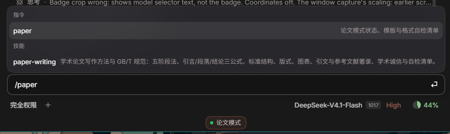

# dsh-paper-mode（论文模式）

[](https://github.com/yezisorft/dsh-paper-mode/actions/workflows/selftest.yml)

一个可开关的 [DeepSeek Harness](https://github.com/deepseek-ai/deepseek-harness) 插件：**启用即进入「论文模式」，停用即完全退出**。

论文模式把「方法」和「规范」两层能力同时挂进会话：

| 层 | 内容 | 停用后的行为 |
| --- | --- | --- |
| 系统提示段 | `paper:mode`（order 550）：五阶段法、引言/段落/结论三公式、标准结构、GB/T 版式与引文硬约束、工作方式与学术诚信 | 从下一次模型请求起消失 |
| 技能 | `paper-writing` runtime skill：完整方法、格式细则、参考文献著录、自检清单；模型按需通过 `skill` 工具加载 | 技能目录中不再出现 |
| 命令 | `/paper`：`status` / `template` / `checklist` 三个分支 | 斜杠命令失效 |
| 界面 | 输入框下方常驻「论文模式」徽标（点击看用法）+ 每个标签页首次进入的一次性提示 | 徽标与提示消失 |



内置技能覆盖：五阶段写作法；引言/段落/结论三公式；期刊与学位论文的标准结构；A4 版式与标题层级；三线表、表题上图题下；公式与数字标点；GB/T 7714—2015 顺序编码制参考文献著录；学术诚信与格式自检清单。插件自带一份《学术论文格式空白模板》，`/paper template` 可直接取出。

## 安装

> 需要 DeepSeek Harness 0.2.x（`engines.dsh >= 0.2.0-rc.1`）。插件没有运行时依赖，只使用 Node 内置模块。

方式一：在 DSH 插件管理里安装 bundle，安装源填 GitHub 简写：

```text
github:yezisorft/dsh-paper-mode
```

方式二：命令行（`dsh` 在 PATH 时）：

```sh
dsh plugin install github:yezisorft/dsh-paper-mode
```

方式三：本地开发目录直接 link 安装，把 `<本目录>` 换成仓库克隆路径：

```sh
dsh plugin install <本目录>
```

**首次安装必须重启一次 DSH。** 新 bundle 的模块映射要与启动时的 loader 快照对齐，DSH 会返回 `restart-required`（原因 `package-moved`）；`dsh-unlag` 之类的刷新按钮只替换已加载插件的代码，首次加载仍由 DSH 启动完成。重启后提示段、技能、`/paper` 与界面徽标一起生效；此后再改动插件可走刷新按钮，无需重启。

## 使用

- `/paper`：显示论文模式状态与用法（插件版本、提示段、已注册技能、资源目录、退出方式）。
- `/paper template`：输出随插件打包的《学术论文格式空白模板》全文。
- `/paper checklist`：输出论文格式自检清单（版式/标题/摘要/关键词/图表/公式/参考文献/文字/诚信）。
- 直接提出论文类任务（撰写、修改、检查论文、开题报告、文献综述、摘要、参考文献等），模型会按 `paper-writing` 技能与提示段契约工作；需要完整方法细节时可要求模型「加载 paper-writing 技能」。

## 停用 / 卸载

- 停用：插件管理里关闭「论文模式」，或调用 `plugin_manager action=set_plugin target=dsh-paper-mode enabled=false`。停用只影响本插件，不改动 profile 里其他插件；重新启用即恢复（无需重启）。
- 卸载：插件管理里移除，或 `plugin_manager action=remove_bundle target=dsh-paper-mode`。

## 开发与验证

```sh
# 插件自身不变量（无需 DSH 进程）
node dev/selftest.mjs
```

自测覆盖 11 项：清单/补丁/显示资源、系统提示段名称与顺序（550）、段文本关键规则、技能正文长度与关键章节、`/paper` 三个分支、注销顺序、Client 半的槽位与本地化注册。CI 在每次 push / PR 时运行同一脚本。

安装后可跑 `dev/verify-live.ps1`（Windows PowerShell）复核 profile 里的安装状态与插件文件。

## 目录

```text
dsh-paper-mode/
├─ index.js                      Host 半：提示段 + 技能 + /paper
├─ client.js                     Client 半：徽标 + 首次进入提示
├─ cordis.patch.yml              bundle patch（插入 dsh-paper-mode 行）
├─ locale/{zh,en}.json           插件管理中的标题/描述
├─ icon.svg                      插件图标（原创）
├─ skills/paper-writing/SKILL.md 技能正文
├─ resources/paper-template.md   学术论文格式空白模板
├─ examples/paper-writing-sample.md  按模板写成的示例论文
├─ dev/selftest.mjs              自测
├─ dev/verify-live.ps1           安装现场校验
└─ docs/                         README 截图
```

## 边界与已知限制

- 「论文模式」的开关是**插件级**的，不提供会话内 `/paper on|off`（避免与会话日志投影耦合）。
- 不打包完整版方法指南；技能正文是面向模型的操作版，模板单独打包。
- 界面只做徽标与一次性提示，不接管布局、不替换宿主组件、不写宿主 DOM。
- 引用与数据真实性由使用者的来源决定：插件要求模型对无法核实的引用标注「待核实」，不保证自动生成的内容可直接提交。

## License

[MIT](LICENSE)
